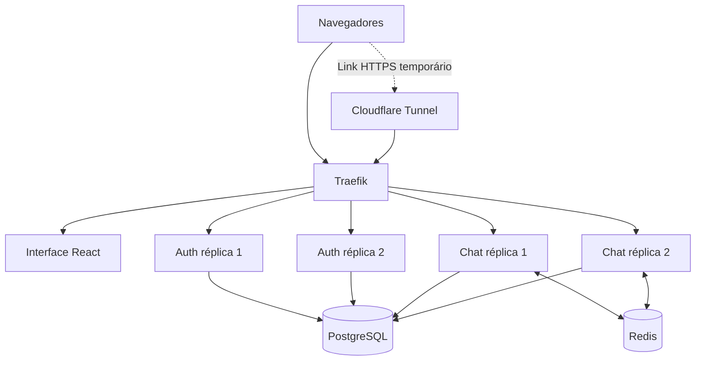
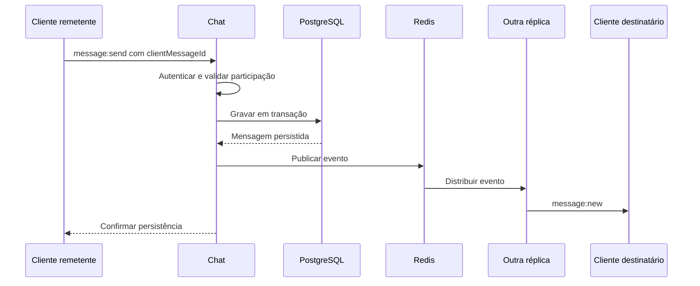

# Arquitetura do chat distribuído

## Estado e objetivo

Projeto acadêmico em dupla de Sistemas Distribuídos, CEFET-MG. A base do marco Ambiente e contratos está implementada e validada conforme `PROGRESSO.md`; funcionalidades de negócio permanecem pendentes.

Fonte dos requisitos: [SD_TP_Final_2026.pdf](enunciado/SD_TP_Final_2026.pdf), duas páginas, fornecido pela professora. O relatório final deve ter até 10 páginas, incluir a URL do código e apresentar as decisões e os resultados dos estudos de caso. A apresentação ocorre em sala na data de entrega, ainda não registrada aqui.

## Requisitos e validação prevista

| Requisito do enunciado | Decisão de projeto | Evidência futura |
|---|---|---|
| Dois microsserviços independentes | Auth e Chat em processos e imagens separados | Inicialização e testes de integração |
| Login e senha | Auth gerencia cadastro e autenticação, com hash de senha | Testes de credenciais e unicidade |
| Interface responsiva | React com lista de conversas e área de mensagens | Testes no navegador em desktop e celular |
| Comunicação persistente e push | Socket.IO configurado para WebSocket | Entrega entre duas sessões |
| Mensagens 1:1 e 1:N | Conversas privadas e grupos com participantes | Testes privados e de grupo |
| Persistência de usuários e mensagens | PostgreSQL com volume persistente | Histórico após reinício da aplicação |
| Nome do grupo, participantes, data/hora e conteúdo | Entidades de conversas, membros e mensagens | Inspeção do histórico e testes de integração |
| Réplicas atualizadas e balanceamento | Duas réplicas de Auth e Chat, Traefik e Redis | Conexões por instância e entrega entre réplicas |
| Alta disponibilidade | Sobrevivência à falha de uma réplica de aplicação | Teste de queda e reconexão |
| Testes unitários e de integração | Regras centrais e fluxos entre componentes | Resultados automatizados |
| 100 usuários simultâneos e 20 grupos | Gerador de carga usando o cliente Socket.IO | Relatório de execução e medições |
| Escalabilidade horizontal | Comparação de uma e duas réplicas de Chat | Latência, vazão e distribuição de conexões |
| Relatório e apresentação | Entrega final preparada pela dupla | PDF até 10 páginas, URL do código e demonstração |

O banco relacional atende à persistência mínima. O uso de banco NoSQL é uma recomendação do enunciado. A linguagem é uma decisão livre de projeto.

## Componentes e organização

Escolha de projeto: TypeScript, React/Vite, Node.js/Express, Socket.IO, PostgreSQL, Redis, Traefik e Docker Compose. Versões estão fixadas nos manifests, lockfile e imagens do Compose. [README.md](../README.md) documenta execução; [CONTRATOS.md](CONTRATOS.md) detalha REST e eventos. A base usa configuração de rotas Traefik por arquivo e nomes explícitos para duas réplicas de cada serviço; testes de recuperação pertencem ao marco posterior.

Auth é proprietário dos usuários e credenciais. Chat é proprietário das conversas, membros e mensagens. Cada serviço possui seu esquema e suas migrações. Chat consulta a API interna de usuários para validar participantes, com timeout e erro explícito se Auth estiver indisponível. As réplicas compartilham o estado persistido e executam a mesma versão da aplicação.

Organização prevista do monorepo: `apps/web`, `services/auth`, `services/chat`, `packages/contracts` e `tests`. Cada serviço separa transporte HTTP/socket, regras de negócio e persistência. Compartilhar contratos de entrada e saída, mantendo as regras nos serviços responsáveis.

Traefik expõe uma entrada na porta 8080, roteia `/api/auth`, `/api/chat` e `/socket.io` e serve a interface na raiz. Usar URLs relativas no navegador. Serviços internos e banco permanecem na rede Docker. Healthchecks orientam o encaminhamento para réplicas aptas. Migrações são uma etapa única anterior à inicialização das réplicas.

## Contratos e dados

| Interface | Responsabilidade |
|---|---|
| `POST /api/auth/register` | Criar usuário com nome de login único e senha |
| `POST /api/auth/login` | Validar credenciais e emitir JWT com expiração |
| `GET /api/auth/users` | Buscar usuários autenticados, sem expor credenciais |
| API interna de usuários | Validar existência dos participantes por identificador |
| `POST /api/chat/conversations` | Criar conversa privada ou grupo com participantes |
| `GET /api/chat/conversations` | Listar somente as conversas do usuário autenticado |
| `GET /api/chat/conversations/:id/messages` | Histórico paginado, com cursor por posição |
| Socket `message:send` | Receber conversa, conteúdo e `clientMessageId`, com confirmação de persistência |
| Socket `message:new` | Entregar mensagem com ID, conversa, remetente, posição e horário do servidor |

O remetente vem da identidade autenticada. A confirmação retorna a mensagem persistida ou erro estruturado. JWT é verificado no HTTP e no handshake do socket, incluindo expiração. Ao expirar durante uma conexão, exigir nova autenticação. Usar assinatura assimétrica, com chave privada em Auth e pública em Chat. Segredos entram por configuração externa e ficam fora do Git.

Entidades mínimas: usuário, conversa, participante e mensagem. Conversa privada possui exatamente dois usuários distintos. A dupla de usuários identifica uma única conversa privada. Grupo possui nome e ao menos dois participantes, incluindo o criador. Participantes são definidos na criação nesta versão. Cada mensagem guarda remetente, conversa, conteúdo, posição e horário UTC do servidor.

## Envio, concorrência e recuperação

- Validar conteúdo e participação antes de gravar. Somente membros podem ler, enviar ou receber mensagens de uma conversa.
- Gerar posição crescente por conversa em transação, com bloqueio da linha da conversa. Usar restrição única para posição e para o identificador de tentativa por remetente. Reenvio com o mesmo identificador e conteúdo retorna o registro existente. Reuso com conteúdo ou conversa diferentes gera conflito.
- Emitir eventos depois do commit. Confirmação significa gravação concluída. O cliente mantém o identificador ao repetir um envio cujo resultado ficou incerto.
- A publicação em Redis pode falhar depois do commit. O histórico no PostgreSQL permite recuperar essa mensagem. O cliente sincroniza ao conectar, reconectar, detectar lacuna e a cada cinco segundos na conversa aberta. Deduplicar por ID e apresentar por posição.
- Ao conectar, o servidor associa o socket às salas de usuário autorizadas. Novas conversas e grupos ficam visíveis pela atualização periódica da lista e pela sincronização ao recuperar foco. O cliente recupera mensagens a partir da última posição conhecida.
- Mostrar os estados de conexão e envio. Evitar apresentar confirmação de persistência como confirmação de leitura pelo destinatário.

## Execução, hospedagem e limites

Desenvolvimento e demonstração rodam em Docker Compose no computador da dupla. Preparar comandos reproduzíveis para configuração, migração, inicialização, dados fictícios, testes e encerramento. PostgreSQL utiliza volume persistente. Reset de dados deve ser uma operação explícita para ambiente de teste.

No dia, publicar a entrada local por Cloudflare Quick Tunnel, com HTTPS e WebSocket. O endereço depende do notebook, da conexão e do processo do túnel. Testar antecipadamente por rede móvel e manter a demonstração local disponível. Usar usuários fictícios e configuração que desabilita cadastro público na demonstração. O link do GitHub permanece no relatório.

A configuração demonstra tolerância à falha de réplicas de aplicação. PostgreSQL, Redis, Traefik e o computador hospedeiro são pontos únicos de falha. Containers em uma máquina demonstram distribuição entre processos e réplica de serviços, com limite de recursos compartilhado. A interpretação de alta disponibilidade para a avaliação precisa ser confirmada com a professora, especialmente sobre falha de infraestrutura e exigência de máquinas distintas. Registrar a resposta antes de considerar a arquitetura validada para entrega final.

## Desenvolvimento e validação futura

| Marco | Responsabilidade inicial | Condição de conclusão |
|---|---|---|
| Ambiente e contratos | Ambos | Clone limpo sobe e contratos são revisados |
| Auth, interface e chat privado | A em Auth/web, B em Chat/banco | Duas sessões autenticadas conversam e recuperam histórico |
| Grupos e autorização | A em interface, B em regras | Membros recebem e terceiros têm acesso negado |
| Réplicas e recuperação | B em infraestrutura, A em cliente | Entrega entre instâncias e recuperação após queda |
| Testes e carga | A em navegador, B em carga | Cenários executados e resultados salvos |
| Relatório e apresentação | Ambos | Relatório revisado e demonstração ensaiada |

Usar testes unitários para credenciais, validações e permissões. Integração usa serviços e banco reais para login seguido de envio, histórico, grupos e reenvio concorrente sem duplicação. Testes no navegador cobrem desktop, celular e falhas visíveis.

Carga usa 100 usuários autenticados e conectados simultaneamente em 20 grupos de cinco membros. Cada usuário envia uma mensagem a cada cinco segundos durante dois minutos após a conexão de todos. Repetir três vezes com uma réplica e três vezes com duas, no mesmo hardware, mantendo as demais configurações. Executar diretamente pelo Traefik local. Guardar configuração, commit, CPU/memória, conexões por instância, vazão, latência p95, erros e entregas esperadas/observadas. Se a carga mínima tiver pouca diferença, executar uma rodada adicional mais intensa e relatar honestamente os resultados.

Para falhas, interromper uma réplica específica, conferir reconexão e recuperação do histórico e medir o tempo até retomada. Repetir login com uma réplica de Auth indisponível. Exigir ausência de mensagens persistidas duplicadas e recuperação de todas as mensagens confirmadas. Relatar perdas transitórias de eventos e seus tempos de recuperação.

## Referências técnicas

- Docker Compose e escala de serviços — https://docs.docker.com/reference/cli/docker/compose/up/
- Socket.IO em múltiplos nós — https://socket.io/docs/v4/using-multiple-nodes/
- Adaptador Redis e limites de propagação — https://socket.io/docs/v4/redis-adapter/
- Bloqueios no PostgreSQL — https://www.postgresql.org/docs/current/explicit-locking.html
- Quick Tunnels — https://developers.cloudflare.com/tunnel/get-started/quick-tunnels/
- GitHub Actions — https://docs.github.com/en/actions/concepts/runners/github-hosted-runners
